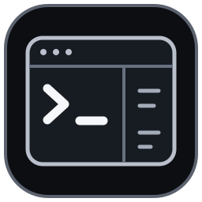

# Tmux Style

English · [Tiếng Việt](README.vi.md)

Eight themes for the standalone **Linux/macOS tmux** and **Windows WezTerm / Windows Terminal + PowerShell** workspaces, with familiar `Ctrl-a` shortcuts derived from the original configuration and [samoshkin/tmux-config](https://github.com/samoshkin/tmux-config). The legacy tmux overlay retains its six themes.

## Linux and macOS: standalone packages (v1.4.0)

Download the [Linux archive](https://github.com/devoralabsapp/tmux-style/releases/download/v1.4.0/tmux-style-linux-1.4.0.tar.gz) or [macOS archive](https://github.com/devoralabsapp/tmux-style/releases/download/v1.4.0/tmux-style-macos-1.4.0.tar.gz), plus its `.sha256` file from the [release](https://github.com/devoralabsapp/tmux-style/releases/tag/v1.4.0). Install tmux >= 3.2, extract the archive, enter its folder, then run:

```bash
# Linux / WSL (install tmux with your distribution's package manager)
bash linux/install.sh --theme hacker

# macOS (brew install tmux first)
bash macos/install.command --theme code

~/.local/bin/tmux-style
~/.local/bin/tmux-style theme black
```

Both packages are architecture-independent scripts for Intel/x86_64 and ARM64 hosts with native tmux. They open a three-pane workspace with a real bottom bar (CPU/RAM, hostname, date/time and window names), preserve processes while switching themes, and support detach/reattach. `Ctrl-a t` opens the theme menu. Installation and backup/restore use owned user files and a separate tmux server; your current `~/.tmux.conf` and shell profiles stay in place. See [Unix setup, shortcuts and restore](unix/README.md).

On tmux versions supporting `prefix-timeout`, Ctrl-a waits two seconds; older versions keep it pending until the next key. The Code theme colors tmux's interface; Bash/Zsh command syntax highlighting remains a separate shell feature.

## New Windows themes

**Code Spectrum** (`theme code`) uses a dark editor-inspired palette with separate colors for commands, parameters, strings, variables, keywords and numbers. **Hacker Matrix** (`theme hacker`) uses a near-black canvas, green phosphor accents and readable comment/error colors. Both switch in the current WezTerm window.


*Illustrative Windows previews generated from the shipped palettes, with sample text and metrics. Syntax coloring applies to the PowerShell command line; applications retain their own highlighting.*

## Command Line / Black

A pure black canvas, white text and quiet gray dividers. Every color in the Black palette is grayscale, including shell syntax colors. No green or other colored accents.


*Recorded from a native tmux test session with sample pane content. The same color palette is available in Windows Terminal.*

<details>
<summary>View all six themes</summary>


</details>

## Windows: download the EXE

**[Download TmuxStyle-Setup-1.4.0.exe](https://github.com/devoralabsapp/tmux-style/releases/download/v1.4.0/TmuxStyle-Setup-1.4.0.exe)** · [Release notes and checksums](https://github.com/devoralabsapp/tmux-style/releases/latest)

1. Run the installer, choose **WezTerm** for the real bottom status bar, then a theme and starting folder.
2. Keep the Desktop shortcut and launch options enabled if you want a ready-to-use, three-pane workspace.
3. Click **Install workspace**. Open **Tmux Style WezTerm** on Desktop next time. The Windows Terminal option uses **Tmux Style Workspace** instead.

The per-user installer uses Windows PowerShell 5.1 and .NET Framework 4.8 on Windows 10/11 (portable WezTerm targets x64). The optional download installs official portable WezTerm with a pinned SHA-256 check, or Microsoft Windows Terminal through winget. No Nerd Font, Oh My Posh or Starship is needed.

**New in v1.2.0: a real bottom bar on Windows.** WezTerm displays numbered tab names, workspace and PREFIX/ZOOM/OFF states, local Windows CPU/RAM, hostname, and date/time. Counters refresh every two seconds; the clock refreshes every second. Narrow windows use a compact status. The bar belongs to the terminal, so it remains separate from fullscreen application output.

**v1.3.0 fixes the premature Ctrl-a cancellation.** WezTerm watches its configuration directory, so earlier versions accidentally reloaded configuration on metric/prompt-state writes and cleared the leader. Volatile files now live in the separate `wezterm-state` sibling directory. `Ctrl-a` can wait its full **two seconds** while metrics continue updating. `theme black` recolors the **current window**, including panes and the bottom bar, without opening another window or restarting shells. Other windows keep their theme. Existing prompts pick up the new palette when next drawn.

**v1.3.1:** WezTerm tab names have no configured character cap. Long names display in full when the tab bar has room; the terminal still handles overflow when many tabs exceed the window width.

| Windows option | Bottom status bar | Ctrl-a handling | Existing Windows Terminal |
| --- | --- | --- | --- |
| **WezTerm (default)** | Tabs, CPU/RAM, hostname, date/time | Native leader; F12 passes shortcuts through | Settings and shortcuts untouched |
| Windows Terminal | No custom bottom bar | Foreground key bridge | Adds eight profiles with backup/restore |

WezTerm uses its own configuration and **Tmux Style WezTerm** shortcut under `%LOCALAPPDATA%\TmuxStyleWindows\wezterm`, with volatile state under the separate `wezterm-state` directory. It does not overwrite `.wezterm.lua`. Its CPU/RAM values describe the **local Windows host**, including while connected over SSH. The Black preview and six-theme gallery are native tmux captures; the new Windows preview is a labeled illustration.

**v1.1.0 fixes the post-install launch failure** shown as “The expression '&' in a pipeline element produced an object that was not valid.” Shortcut creation and launching now use separate variables/scopes, and the packaged regression test exercises both options together.

| Shortcut | Windows behavior |
| --- | --- |
| `Ctrl-a c` | New tab in the focused profile and working directory |
| `Ctrl-a \|` / `Ctrl-a -` | Split right / below |
| `Ctrl-a r` / `Ctrl-a R` | Rename tab / workspace (WezTerm) or window (Terminal) |
| `Ctrl-a z` | Zoom / restore pane |
| `Ctrl-a x` / `Ctrl-a X` | Close pane / tab |
| `Ctrl-a` + arrow | Focus an adjacent pane |
| `Ctrl-a Ctrl-arrow` | Resize pane |
| `F12` | Toggle pass-through; use OFF for tmux over SSH |

`theme black` recolors the current WezTerm window, or opens a tab in Windows Terminal. `workspace` opens a three-pane window at the current directory. WezTerm needs no external keyboard bridge. The Windows Terminal bridge handles only predefined mappings while Terminal is in front; it does not record typed content or add itself to Windows startup. Closing windows ends their terminal sessions. [Full shortcut table, native differences and restore instructions](windows-terminal/README.md).

The installer backs up existing settings and owned assets, preserves unrelated profiles/preferences/non-conflicting keys, and includes **Restore previous settings**. It changes neither the shared `$PROFILE` nor execution policy or Windows' default terminal application.

## Existing samoshkin setup: legacy tmux overlay

Requires **tmux >= 3.2** and the samoshkin base configuration already installed under `~/.tmux`.

```bash
git clone https://github.com/devoralabsapp/tmux-style.git
cd tmux-style
bash install.sh black
tmux source-file ~/.tmux.conf
```

Supported names: `black`, `aurora`, `midnight`, `ember`, `paper`, `neon`. Without a name, the installer keeps Midnight as its default. Every install creates a backup and preserves the existing `~/.tmux.conf` symlink. Existing sessions can stay open.

| Theme | Style |
| --- | --- |
| [Command Line / Black](preview/black.png) | Black canvas, white text, gray dividers |
| [Aurora](preview/aurora.png) | Mint/lavender, tabs on top locally |
| [Midnight / Cyan](preview/midnight-cyan.png) | Compact navy/cyan workspace |
| [Ember](preview/ember.png) | Warm amber with numbered pane headers |
| [Paper / Ink](preview/paper.png) | Warm light background and ink-black tabs |
| [Neon / Circuit](preview/neon.png) | Orchid accents and two rows of context |

The tmux status bar adapts to window width and shows COPY/PREFIX/ZOOM/OFF states. Existing sysstat CPU/RAM widgets appear on wide terminals. Personal shortcuts, clipboard behavior and SSH/F12 handling are retained. Remote sessions keep the samoshkin bottom status position. Applications such as Neovim can still use their own color schemes.

To restore tmux, use the backup path printed by the installer:

```bash
cat ~/.tmux/backups/your-backup-file > ~/.tmux.conf
tmux source-file ~/.tmux.conf
```

## Build and validation

```powershell
.\windows-terminal\build.ps1 -RunTests
```

The Windows build reads `VERSION`, embeds the multi-size application icon, and produces an EXE plus SHA-256 checksums under `dist/`. Its packaged self-test runs on Windows PowerShell 5.1 with temporary settings: eight themes in both backends, JSONC preservation, exact backup/restore, upgrade rollback and edit protection, prompt exit codes, grayscale checks, native PSReadLine syntax roles, separate runtime-state paths, native key-map resolution, shortcut/post-install launch regression, checksum rejection and Windows counter sampling. CI validates Microsoft's schema and uses the real WezTerm Lua interpreter to check all eight configs, status, live switching, F12 and layout callbacks.

The EXE is **not code signed**. Source and checksums are provided. This project is an independent installer/configuration, not Microsoft Windows Terminal itself. See [NOTICE.md](NOTICE.md) for provenance and licensing. Original Windows code and logo assets use the [Windows MIT license](windows-terminal/LICENSE); existing tmux and third-party files retain their own terms.
