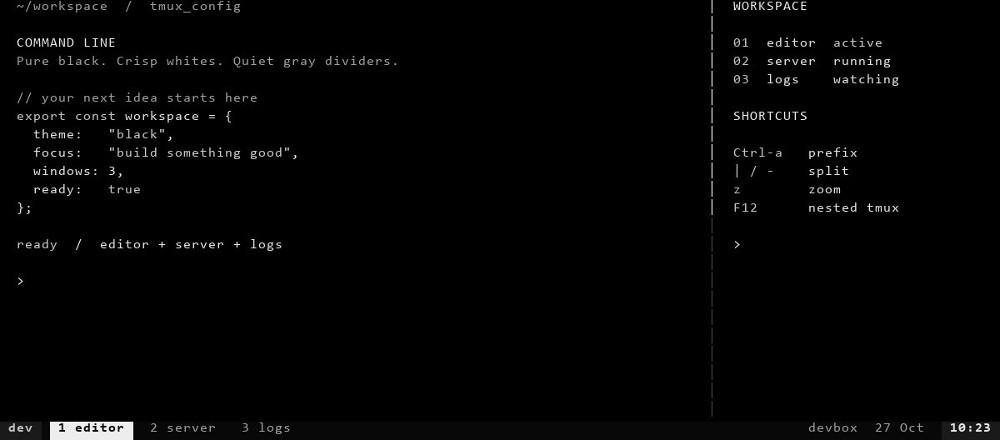
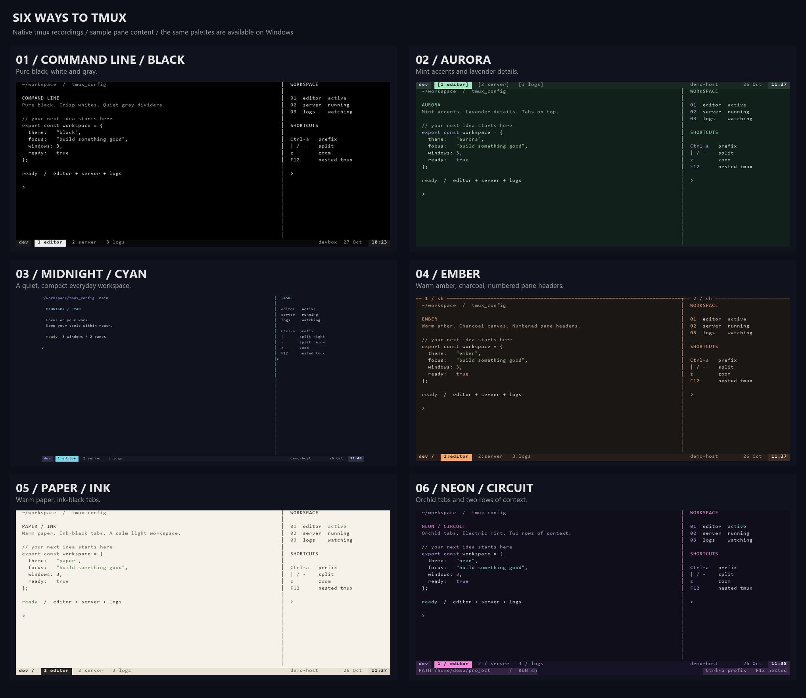

# Tmux Style

[English](README.md) · Tiếng Việt

Bản 1.1.0 sửa lỗi mở workspace sau bước tạo shortcut, thêm theme Command Line đen–trắng và icon riêng cho EXE.



Sáu giao diện cho tmux và Windows Terminal: **Aurora**, **Midnight / Cyan**, **Ember**, **Paper / Ink**, **Neon / Circuit**, **Command Line / Black**. Giữ cấu hình tmux cá nhân của the original tmux configuration, dựa trên [samoshkin/tmux-config](https://github.com/samoshkin/tmux-config).



## Windows: tải EXE và cài

Tải **[TmuxStyle-Setup-1.1.0.exe](https://github.com/devoralabsapp/tmux-style/releases/latest)**, chọn màu và thư mục khởi động, rồi bấm **Install workspace**.

- Cài theo tài khoản hiện tại, không yêu cầu quyền quản trị.
- Có thể cài Windows Terminal chính thức qua winget nếu máy chưa có và bạn bật tùy chọn tải.
- Tạo workspace PowerShell ba pane, prompt có đường dẫn và nhánh Git.
- Có bộ remap `Ctrl-a` theo thói quen tmux, hoạt động khi Windows Terminal ở phía trước; F12 tắt/bật remap.
- Có backup và nút khôi phục cấu hình; giữ profile, tùy chọn và phím không xung đột.
- EXE chưa ký số; mã nguồn, hướng dẫn build và SHA-256 đi kèm Release.

| Phím chính | Tác dụng Windows |
| --- | --- |
| `Ctrl-a c` | Tab mới, giữ profile/thư mục hiện tại |
| `Ctrl-a \|` / `Ctrl-a -` | Chia phải / chia dưới |
| `Ctrl-a r` / `Ctrl-a R` | Đổi tên tab / cửa sổ |
| `Ctrl-a z` | Zoom / trả pane về bố cục cũ |
| `Ctrl-a x` / `Ctrl-a X` | Đóng pane / tab |
| `Ctrl-a` + mũi tên | Chuyển pane |
| `Ctrl-a Ctrl-mũi tên` | Đổi kích thước pane |
| `F12` | Tắt/bật bộ remap, dùng khi SSH vào tmux |

Lệnh `theme neon` mở tab màu Neon; `workspace` mở workspace ba pane tại thư mục hiện tại. Tiến trình vẫn theo vòng đời cửa sổ Terminal; đây không phải tmux native hay cơ chế detach/attach. [Bảng phím đầy đủ, khác biệt và hướng dẫn build](windows-terminal/README.md).

## Linux / macOS / WSL: tmux

Yêu cầu tmux **>= 3.2** và bộ nền samoshkin đã cài ở `~/.tmux`.

```bash
git clone https://github.com/devoralabsapp/tmux-style.git
cd tmux-style
bash install.sh aurora
tmux source-file ~/.tmux.conf
```

Đổi `aurora` thành `midnight`, `ember`, `paper`, `neon` hoặc `black`. Không truyền tên sẽ chọn Midnight. Mỗi lần cài đều sao lưu; giữ symlink `~/.tmux.conf` của samoshkin. Không cần đóng session đang chạy.

| Mẫu | Phong cách |
| --- | --- |
| [Command Line / Black](preview/black.png) | Nền đen, chữ trắng, viền xám |
| [Aurora](preview/aurora.png) | Mint/lavender, tab trên; SSH giữ thanh dưới theo cấu hình nền |
| [Midnight / Cyan](preview/midnight-cyan.png) | Xanh đen, cyan, một dòng gọn |
| [Ember](preview/ember.png) | Cam ấm, tiêu đề đánh số từng pane |
| [Paper / Ink](preview/paper.png) | Nền giấy sáng, chữ mực, tab đen |
| [Neon / Circuit](preview/neon.png) | Tím hồng, thanh hai dòng có đường dẫn/lệnh đang chạy |

Thanh trạng thái tự rút gọn theo chiều rộng, có nhãn COPY/PREFIX/ZOOM/OFF; CPU/RAM xuất hiện từ 160 cột qua plugin sysstat sẵn có. Phím cá nhân, clipboard, plugin, thư mục làm việc và hành vi F12/SSH được giữ. Đoạn `swap-pane` bị comment dở trong bản gốc đã được sửa để tiếp tục tắt binding đó.

Hoàn tác tmux bằng đường dẫn backup được script in ra:

```bash
cat ~/.tmux/backups/ten-file-backup > ~/.tmux.conf
tmux source-file ~/.tmux.conf
```

`build_themes.py` tạo lại bốn mẫu từ `tmux.conf`. Bốn mẫu mới đặt màu mặc định của pane; Midnight dùng màu mặc định của terminal. Ứng dụng tự đặt màu như Neovim vẫn có theme riêng. Nội dung pane trong ảnh là ví dụ; thanh trạng thái và viền được ghi lại từ tmux thật.

## Kiểm chứng và nguồn gốc

- tmux 3.6: load/reload, COPY/PREFIX/ZOOM/F12, 60–160 cột, SSH, sysstat, chuyển qua cả sáu theme và backup/restore.
- Windows: EXE tự kiểm tra gói trên Windows PowerShell 5.1; merge JSONC, giữ cấu hình cũ, backup/restore từng byte, prompt và bộ giải ánh xạ phím. Schema được kiểm tra bằng lược đồ Microsoft.
- CI build và chạy lại kiểm thử EXE; `dist/` là kết quả build, không commit binary vào mã nguồn.

Xem [NOTICE.md](NOTICE.md) về nguồn cấu hình cũ và giấy phép; phần Windows mới có giấy phép MIT riêng. Bản gốc và schema bên thứ ba giữ nguồn gốc/điều khoản tương ứng.
