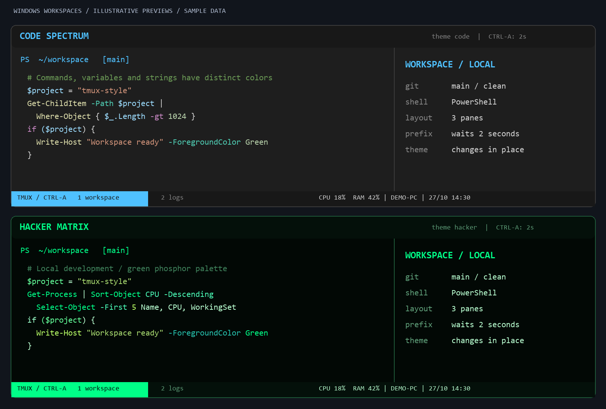

# Windows workspaces + tmux-style keys

Download **TmuxStyle-Setup-1.3.0.exe** from the [GitHub Release](https://github.com/devoralabsapp/tmux-style/releases/latest), choose a terminal, theme and starting folder, then click **Install workspace**. The installer is per-user and uses Windows PowerShell 5.1 and .NET Framework already included with Windows 10/11. The optional terminal download requires internet. Windows Terminal installation also needs App Installer/winget.

The executable is not code signed. Source, build scripts and SHA-256 checksums are provided with the release. It does not bundle or impersonate Microsoft Windows Terminal.

## WezTerm: real bottom bar (default)

Choose **WezTerm** for a terminal-owned bottom bar containing numbered tab names, workspace, PREFIX/ZOOM/OFF indicators, local Windows CPU/RAM, hostname and date/time. CPU/RAM refresh every two seconds; the clock refreshes every second. Small windows show a compact status; missing or stale counter data shows `--`. These are local Windows values, including during SSH sessions.

The **Tmux Style WezTerm** Desktop shortcut opens three PowerShell panes. The runtime is official portable WezTerm, pinned in `wezterm-runtime.json` with the checksum published upstream. Existing WezTerm on PATH can also be used. The portable runtime targets Windows x64. It stays inside `%LOCALAPPDATA%\TmuxStyleWindows\wezterm`; `.wezterm.lua`, Windows Terminal settings and its existing shortcut remain untouched.

**v1.3.0 leader fix:** live metrics and per-pane prompt state now live in the sibling `%LOCALAPPDATA%\TmuxStyleWindows\wezterm-state` directory. WezTerm watches the configuration directory itself; writing runtime data there caused repeated reloads that canceled Ctrl-a before two seconds. Upgrade migrates the collector and stops the legacy output-path instance. Configuration still reloads normally when its own files change.

All eight themes are selectable: Aurora, Midnight, Ember, Paper, Neon, Command Line, **Code Spectrum** and **Hacker Matrix**. `theme code` adds editor-inspired syntax roles to the PowerShell command line; `theme hacker` uses a near-black/green palette with distinct comments and errors. Application-specific syntax highlighting remains controlled by those applications.



*Illustration generated from the shipped palettes, with sample data.*

WezTerm handles `Ctrl-a` natively, without the Windows Terminal keyboard bridge. Press and release `Ctrl-a`, then press the next key within **two seconds**:

| Keys | WezTerm behavior |
| --- | --- |
| `Ctrl-a c`, `Ctrl-a \|`, `Ctrl-a -` | New tab, split right, split below; inherit current directory |
| `Ctrl-a r` / `Ctrl-a R` | Rename tab / workspace |
| `Ctrl-a z`, `Ctrl-a x` / `Ctrl-a X` | Zoom, close pane / tab with confirmation when needed |
| `Ctrl-a Tab`, `Ctrl-a 1` … `9` | Last active tab, select numbered tab |
| `Ctrl-a` + arrow / `Ctrl-arrow` | Focus / resize pane |
| `Ctrl-a Ctrl-o` | Rotate panes clockwise |
| `Ctrl-a [` / `Ctrl-a ]` | Native copy mode / paste clipboard |
| `Ctrl-a Ctrl-a` | Forward literal Ctrl-a |
| `Ctrl-a Ctrl-r` / `Ctrl-a Ctrl-s` | Reload configuration / hide or show tab bar |
| `F12` | Toggle OFF pass-through; disables leader and default keyboard shortcuts except the resume keys |
| `Shift+Up` / `Shift+Down` | Enter / leave pass-through |
| `Shift+Left/Right`, `Ctrl+Shift+Left/Right`, `Ctrl+T` | Change tab, move tab, new tab while local bindings are enabled |
| `Ctrl+Alt+W` | New three-pane tab at the current directory |

`theme black` recolors the **current WezTerm window**, including all its tabs, panes and bottom bar. Shells and processes stay alive; other windows keep their theme. Existing prompts synchronize at their next redraw; newly created panes use the selected palette. Theme switching preserves F12 pass-through, zoom and hidden-bar settings. It applies to this window's lifetime; the Desktop shortcut still uses the installer-selected starting theme. `workspace` opens another three-pane window at the current directory. Native WezTerm defaults such as `Ctrl+Shift+C/V` remain available in normal mode. The personal tmux session-link/merge, monitor, detach/attach and buffer-history commands are not implemented. WezTerm's Shift+Up/Down controls local pass-through; it does not emit the original Alt+F12/Alt+F11 remote signals. Closing windows ends their panes.

After upgrading from v1.2.0 with shells still open, open one new tab with `Ctrl-a c` to load the updated `theme` command. Existing PowerShell panes can load the updated prompt without restarting their process:

```powershell
. ([scriptblock]::Create([IO.File]::ReadAllText("$env:LOCALAPPDATA\TmuxStyleWindows\wezterm\shell.ps1"))) -NoBanner
```

The small `TmuxStyle.Metrics.exe` collector reads Windows CPU/memory counters and writes a local JSON sample. It runs once for this asset directory and exits after all WezTerm GUI processes have been closed for about 20 seconds. It has no network access, keyboard hook or startup entry.

Close Tmux Style WezTerm windows before upgrade/restore. In the installer, select **WezTerm** and click **Restore previous settings**. Owned configs, prompt and shortcut are backed up in the separate `wezterm\backups` directory. Restore and upgrade refuse to overwrite files edited since installation. The portable runtime remains available after restoring the configuration.

## Windows Terminal: keys matching original tmux configuration

The following section applies to the **Windows Terminal** installer option. This backend has themed prompts, tabs and panes, but **no custom bottom bar**. The Black sample below is a native tmux capture and does not show Windows Terminal capabilities.

Press and release **Ctrl-a**, then the second key. The prefix waits up to two seconds; Escape cancels it. `Ctrl-a Ctrl-a` forwards a literal Ctrl-a to the terminal.

| Original tmux binding | Windows behavior |
| --- | --- |
| `Ctrl-a c` | New tab using the focused profile and working directory |
| `Ctrl-a \|` | Split right |
| `Ctrl-a -` | Split below |
| `Ctrl-a r` | Rename tab |
| `Ctrl-a R` | Rename window |
| `Ctrl-a Tab` | Switch to a recently used tab |
| `Ctrl-a z` | Zoom / restore pane (inherited default in the personal tmux config) |
| `Ctrl-a x` | Close pane |
| `Ctrl-a X` | Close tab |
| `Ctrl-a Q` | Close the window using Terminal's close behavior |
| `Ctrl-a Ctrl-o` | Swap with the next pane |
| `Ctrl-a` + arrow | Focus adjacent pane |
| `Ctrl-a Ctrl-arrow` | Resize pane |
| `Ctrl-a 1` … `9` | Select tabs 1–9 |
| `Ctrl-a [` | Windows Terminal keyboard selection mode |
| `Ctrl-a ]` | Paste the Windows clipboard |
| `Ctrl-a Ctrl-e` | Edit Terminal settings JSON |
| `Ctrl-a Ctrl-s` | Toggle Terminal focus mode (hide/show tab/title chrome) |
| `Ctrl-a d` | Minimize the window; processes keep running |
| `Ctrl-a ?` | Terminal command palette |
| `F12` | Turn the key bridge off/on; use OFF for tmux over SSH |
| `Shift+Up` | Send Alt+F12, use Ctrl-b prefix, disable Shift tab controls |
| `Shift+Down` | Send Alt+F11, restore Ctrl-a and enable Shift tab controls |
| `Shift+Left/Right`, after Shift+Down | Previous/next tab |
| `Ctrl+Shift+Left/Right`, after Shift+Down | Move tab left/right |
| `Ctrl+T`, after Shift+Down | New tab in the focused profile/directory |

Linking/merging sessions (`L`, `Ctrl-u`), detaching other clients (`D`), window activity/silence monitors (`m`, `M`) and tmux buffer history (`Enter`) have no equivalent in this native setup. `Ctrl-r` after the prefix is not mapped: Terminal automatically reloads settings JSON; open a new Tmux Style tab to reload the prompt. The minimize, focus-mode, selection and Windows clipboard mappings are approximations, rather than full tmux session semantics. Closing a Terminal window ends its PowerShell sessions.

The bridge only handles keys while the **WindowsTerminal** process owns the foreground window. It does not record keys, inspect typed text, read the clipboard or make network requests. It appears in the system tray; its menu can turn mappings off or exit. It starts from Tmux Style profiles, runs once per user session, and exits after Terminal has been closed for about 20 seconds. It does not add itself to Windows startup. F12 turns off this bridge, while Windows Terminal's own shortcuts remain available. Elevated Terminal windows may require a bridge at matching privilege; the normal per-user setup targets non-elevated windows.

Direct shortcuts also remain: `Ctrl+Alt+V/H` splits, `Alt+Arrow` focuses panes, `Alt+Shift+Arrow` resizes, `Ctrl+Shift+Z` zooms and `Ctrl+Alt+W` creates a three-pane tab.

## Terminal sample


This example was recorded from a native tmux test session with sample pane content. Windows Terminal uses the same Black color palette.

## Themes and prompt

Eight profiles are installed: Aurora, Midnight, Ember, Paper, Neon, Command Line, Code Spectrum and Hacker Matrix. `theme black` opens the monochrome profile. `theme code` or `theme hacker` opens the corresponding profile tab. `workspace` opens a three-pane window at the current directory. The prompt shows the directory and Git branch, when available. No Nerd Font, Oh My Posh or Starship is required.

The installer preserves unrelated profiles, preferences and non-conflicting keys. It intentionally replaces the keys listed above and sets the selected theme as the default profile. `$PROFILE`, PATH, execution policy and Windows' default terminal application are not changed.

## Backup and restore

Settings, owned assets and an existing workspace shortcut are backed up under `%LOCALAPPDATA%\TmuxStyleWindows\backups`. To restore the most recent pre-installation state, close workspace windows and use **Restore previous settings** in the installer. It stops if newer user edits would be lost. Standard Terminal first-launch normalization is accepted by the restore check.

Installed assets live under `%LOCALAPPDATA%\TmuxStyleWindows`. Windows Terminal itself remains installed after restoring the configuration.

## Build and test

On Windows, from the repository root:

```powershell
.\windows-terminal\build.ps1 -RunTests
```

The build uses the Windows .NET Framework compiler. No downloaded compiler package or PowerShell 7 runtime is included in the EXE. `dist/` contains the installer, checksums and self-test report. The packaged self-test uses temporary settings, exercises all eight themes in both backends, checks backups/restore, upgrade rollback, edit protection, checksum rejection, live Windows counters, separate volatile-state paths, native PSReadLine syntax roles, prompt exit codes and key-map resolution. It does not install a keyboard hook or touch production settings. CI validates Microsoft's settings schema and runs `test-wezterm-lua.ps1` with the pinned real WezTerm runtime to check eight configurations plus status, live switching, F12, layout and Windows URL-path handling.

GUI capture was unavailable in the local test environment (capture timeout); the release was checked by compiling and running the packaged self-test and by validating the native settings, not by claiming every shortcut was pressed in UI.

References: the original tmux configuration, [Terminal actions](https://learn.microsoft.com/en-us/windows/terminal/customize-settings/actions), [upstream multi-key prefix request](https://github.com/microsoft/terminal/issues/1334).

## v1.1.0 launch fix

Creating a Desktop shortcut no longer overwrites the executable used by the post-install launcher. Setup steps execute in separate scopes. The packaged regression test enables both shortcut creation and launch, then checks the complete three-pane argument list using a mock Terminal. A launch failure after successful configuration is reported as a launch warning, rather than claiming the configuration failed.
